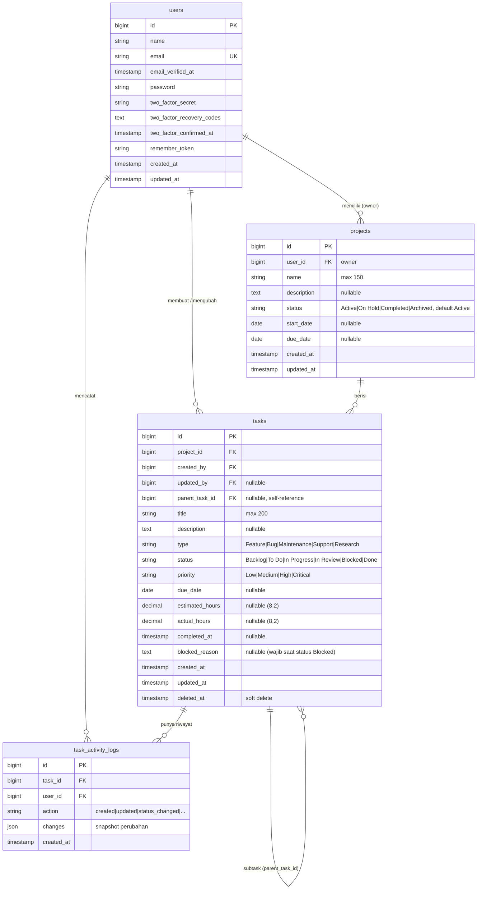

# ERD — DevT

Entity Relationship Diagram untuk backend (`backend_devt`, Laravel + PostgreSQL).
Frontend tidak memiliki basis data sendiri; seluruh data diambil dari REST API
`/api/v1`.

## Catatan relasi & aturan

- **Kepemilikan bersifat owner-only**: `projects.user_id` adalah pemilik; sebuah
  task dapat diakses bila user adalah pemilik project (`ProjectPolicy`,
  `TaskPolicy`). Belum ada konsep tim/role.
- `projects.user_id`, `tasks.project_id`, `tasks.created_by`, dan
  `task_activity_logs.user_id` memakai `ON DELETE RESTRICT` — penghapusan user
  yang masih memiliki data ditolak.
- `tasks.updated_by` memakai `ON DELETE SET NULL`.
- `tasks` memakai **soft delete** (`deleted_at`); subtask ikut terhapus berantai
  saat parent dihapus (`cascadeOnDelete` pada `parent_task_id`).
- `task_activity_logs` tidak punya `updated_at` (append-only) dan terhapus
  berantai saat task-nya dihapus.
- Enum disimpan sebagai `string` + index (bukan tipe enum PostgreSQL).

## Pemetaan ke frontend

| Tabel | Tipe frontend (`lib/types.ts`) | Halaman |
| --- | --- | --- |
| `users` | `User` | `/profile`, topbar |
| `projects` | `Project` | `/projects`, `/projects/[id]` |
| `tasks` | `Task` | `/tasks`, `/tasks/[id]` |
| `task_activity_logs` | `TaskActivityLog` | tab riwayat di `/tasks/[id]` |
