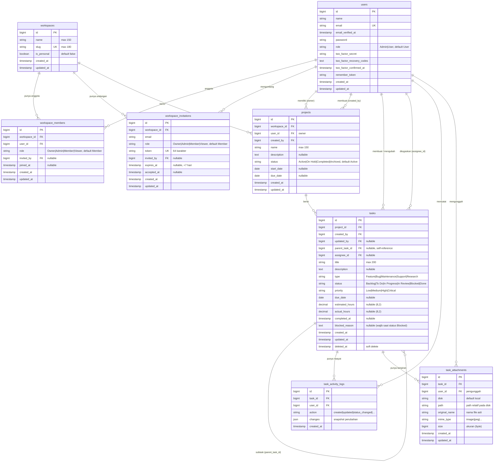

# ERD — DevT

Entity Relationship Diagram untuk backend (kini Route Handlers Next.js +
Prisma; skema di `prisma/schema.prisma`, semula Laravel `backend_devt`).
Frontend tidak memiliki basis data sendiri; seluruh data diambil dari REST API
`/api/v1`.

## Catatan relasi & aturan

- **Kolaborasi berbasis workspace:** setiap project berada di dalam tepat satu
  workspace. Akses ditentukan keanggotaan `workspace_members` + perannya
  (`Owner`/`Admin`/`Member`/`Viewer`). Setiap user punya satu **personal
  workspace** (`is_personal=true`) yang dipakai bila header `X-Workspace-Id`
  tidak dikirim.
- **Peran platform vs peran tim:** `users.role` (`Admin`/`User`) hanya untuk
  super-admin platform (default `User`); peran kolaborasi disimpan per-workspace
  pada `workspace_members.role`. Kolaborator pertama saat membuat workspace
  otomatis menjadi `Owner`.
- **Undangan:** `workspace_invitations` menyimpan undangan via email dengan
  `token` acak 64 karakter dan masa berlaku 7 hari. `role` tidak boleh `Owner`.
  Undangan untuk email yang sudah menjadi anggota / sudah punya undangan
  pending ditolak (`422`); token yang tidak valid lagi (diterima/dicabut/
  kedaluwarsa) → `410`.
- `projects.workspace_id` dan `projects.created_by` **wajib** (diisi lewat
  backfill: project lama pindah ke personal workspace pemiliknya). `user_id`
  tetap dipertahankan sebagai pemilik historis.
- Penghapusan **workspace** diblokir (`409`) bila masih punya project; workspace
  personal tidak dapat dihapus. `workspace_members` / `workspace_invitations`
  terhapus berantai saat workspace dihapus.
- `tasks.assignee_id` (nullable, FK `users`) menunjuk penanggung jawab; harus
  merupakan anggota workspace project tersebut. `ON DELETE SET NULL`.
- `projects.user_id`, `tasks.project_id`, `tasks.created_by`, dan
  `task_activity_logs.user_id` memakai `ON DELETE RESTRICT` — penghapusan user
  yang masih memiliki data ditolak.
- `tasks.updated_by` memakai `ON DELETE SET NULL`.
- `tasks` memakai **soft delete** (`deleted_at`); subtask ikut terhapus berantai
  saat parent dihapus (`cascadeOnDelete` pada `parent_task_id`).
- `task_activity_logs` tidak punya `updated_at` (append-only) dan terhapus
  berantai saat task-nya dihapus.
- `task_attachments` terhapus berantai saat task-nya dihapus; `user_id` memakai
  `ON DELETE RESTRICT`. File fisik disimpan di disk `local`
  (`storage/app/private`) dan diakses lewat **signed URL** (`/storage/{path}`),
  bukan akses publik.
- Enum disimpan sebagai `string` + index (bukan tipe enum PostgreSQL).

## Pemetaan ke frontend

| Tabel | Tipe frontend (`lib/types.ts`) | Halaman |
| --- | --- | --- |
| `users` | `User` (+ `role`, `workspaces`) | `/profile`, topbar |
| `workspaces` | `Workspace` | pemilih workspace di topbar |
| `workspace_members` | `WorkspaceMember` | `/workspaces/[id]`, peta `membersById` |
| `workspace_invitations` | `WorkspaceInvitation` | `/workspaces/[id]`, `/invitations/[token]` |
| `projects` | `Project` | `/projects`, `/projects/[id]` |
| `tasks` | `Task` (+ `assignee_id`, `assignee`) | `/tasks`, `/tasks/[id]` |
| `task_activity_logs` | `TaskActivityLog` | tab riwayat di `/tasks/[id]` |
| `task_attachments` | `TaskAttachment` | galeri lampiran di `/tasks/[id]` |
